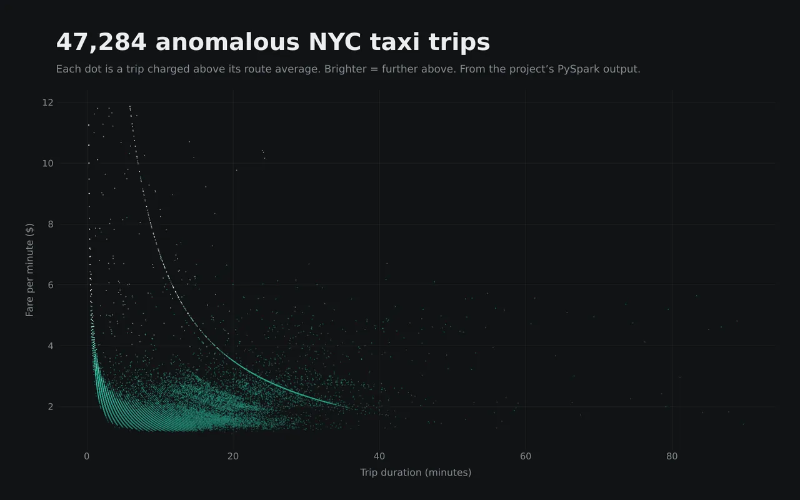

# 🚖 Taxi Route Anomaly Detection

Find overcharged taxi trips and abnormal routes in NYC taxi data, then check any route in a small web app.


<p align="center">
  
  <br><sub>Flagged trips from the PySpark output, fare per minute against trip duration (plotted subset).</sub>
</p>

**In the results:** 46,658 overcharged trips across 5,573 routes, and 48,743 route anomalies across 4,686 routes.

## What it does

Pick a pickup and a dropoff zone (by ID or by name) and the app tells you:

- **Overcharging**: trips on that route whose fare per km is far above the route's average
- **Route anomalies**: trips whose fare per minute is far above the route's average
- **Route analytics**: the expected vs observed fare rate, average trip time and number of trips analysed, with an alert when the observed rate is more than 10% above normal
- **A cheaper pickup**: another pickup zone in the same borough with a lower average fare rate to the same destination, and the estimated saving

## How it works

```
NYC TLC trip records ──► PySpark batch job ──► outputs/results/*.csv ──► Streamlit app
 (pickup/dropoff zone,     group by route,        overcharging_cases.csv      lookup by route,
  fare, distance, time)    fare/km & fare/min,    route_anomalies.csv         analytics, cheaper
                           flag outliers                                      pickup suggestion
```

1. Each trip is keyed by its route: `PULocationID_DOLocationID` (for example `100_1`).
2. For every route, the batch job computes the average **fare per km** and **fare per minute**.
3. Trips far above their route's average are written to the two result files.
4. The app joins those results with the official TLC zone lookup so you can search by zone name.

## Run it locally

```bash
git clone https://github.com/rohitpawalia28/taxi-route-anomaly-detection.git
cd taxi-route-anomaly-detection
pip install -r requirements.txt
streamlit run web_app.py
```

The app opens at `http://localhost:8501`. Try **Location ID** `100` → `1`.

## Project structure

```
├── web_app.py                      # Streamlit app
├── outputs/results/
│   ├── overcharging_cases.csv      # route_id, fare_per_km, avg_fare_per_km, fare, distance
│   └── route_anomalies.csv         # route_id, fare_per_min, avg_fare_per_min, duration
├── data/taxi_zone_lookup.csv       # TLC zone ID → zone name and borough
└── requirements.txt
```

## Data

Trip records and the zone lookup come from the [NYC Taxi & Limousine Commission trip record data](https://www.nyc.gov/site/tlc/about/tlc-trip-record-data.page).

## Author

**Rohit Kumar** · [rohitkumar.app](https://rohitkumar.app) · [LinkedIn](https://www.linkedin.com/in/rohit-kumar-6a7b4134b/)
